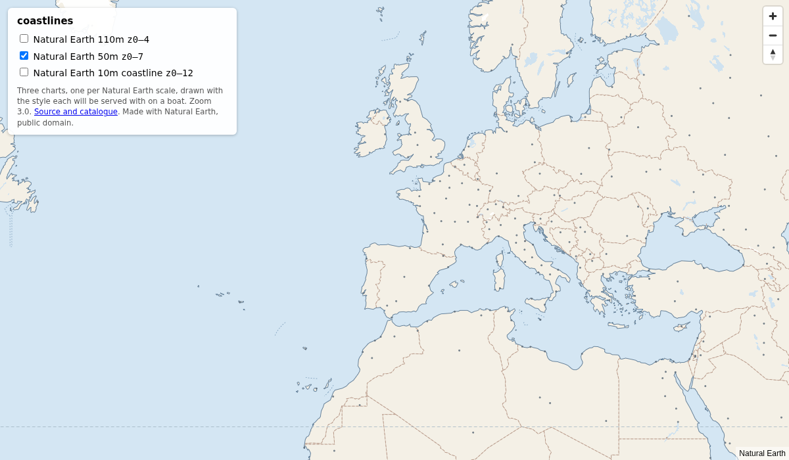
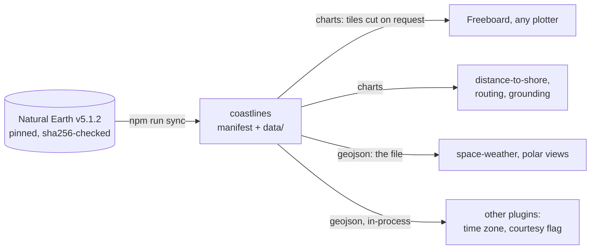
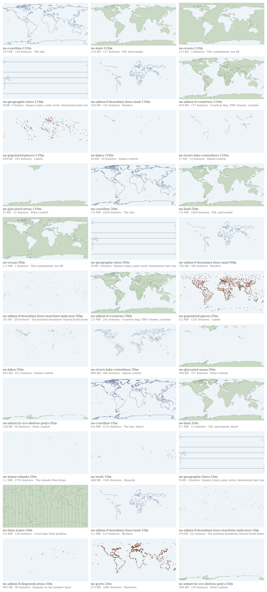

# coastlines

> **Reset.** Before 0.1.0 this package shipped a compact derived format, since
> withdrawn ([post-mortem](https://github.com/mark-brannan/portolani/issues/25)).
> The name stays and gets a new job, below.

Natural Earth geography on a boat, installed rather than fetched. One
package holds the marine catalogue at all three scales, byte for byte as
Natural Earth published it, sha256-pinned, as plain GeoJSON. A browser page
imports a file; a Signal K plugin (next) serves the same files to every
chart plotter and plugin on the boat, so nobody ships the same coastline
twice.

```js
import { manifest, find, localUrl } from 'coastlines'
import { readFile } from 'node:fs/promises'

const entry = find('ne-coastline-50m')          // { bytes: 1640858, sha256: 'sha256:…', … }
const world = JSON.parse(await readFile(localUrl(entry), 'utf8'))
```

The subpath `coastlines/data/<id>` resolves to the `.geojson` file for any
tool that can load one; `manifest.json` and `charts.json` are plain JSON. A
file in another format carries its extension, `coastlines/data/gshhg-land-h.shp`,
and `shapefilePolygons` from the package reads it:

```js
import { find, localUrl, shapefilePolygons } from 'coastlines'

const land = find('gshhg-land-h')               // { source: 'gshhg', format: 'shp', … }
const polygons = shapefilePolygons(await readFile(localUrl(land)))  // 144,749 of [outerRing]
```

**See it:** [the basemap on GitHub Pages](https://mark-brannan.github.io/coastlines/),
the three default charts, drawn with the styles the plugin will serve.

[](https://mark-brannan.github.io/coastlines/)

## One provider, four consumers



The plugin faces, `charts` and `geojson`, are the next work item; the
design is written up in [#17](https://github.com/mark-brannan/coastlines/issues/17).
This release is the data and the authored styles, which the demo already
draws.

## The catalogue

36 files from two sources. From Natural Earth, every 50m and 110m file in
the marine catalogue, and at 10m the coastline, the land and every other file
that fits a 5 MB response body; the rest of 10m and the bathymetry set belong
to companion packages. From GSHHG 2.3.7, the "h" land polygons, the next rung
of coastline above Natural Earth's 10m (vertex spacing median 707 m), as the
published shapefile, with the two licence notices that travel with it.

<!-- catalogue:start -->
| Import `coastlines/data/…` | Layer | Scale | Geometry | Raw | Why a boat wants it |
| --- | --- | --- | --- | ---: | --- |
| `ne-coastline-110m` | coastline | 110m | lines | 137 KB | The line |
| `ne-land-110m` | land | 110m | polygons | 135 KB | Fill, land masks |
| `ne-ocean-110m` | ocean | 110m | polygons | 115 KB | The complement; sea fill |
| `ne-geographic-lines-110m` | geographic_lines | 110m | lines | 59 KB | Equator, tropics, polar circles, International Date Line |
| `ne-admin-0-boundary-lines-land-110m` | admin_0_boundary_lines_land | 110m | lines | 332 KB | Borders |
| `ne-admin-0-countries-110m` | admin_0_countries | 110m | polygons | 819 KB | Courtesy flag, VHF scheme, customs |
| `ne-populated-places-110m` | populated_places | 110m | points | 639 KB | Labels |
| `ne-lakes-110m` | lakes | 110m | polygons | 36 KB | Inland context |
| `ne-rivers-lake-centerlines-110m` | rivers_lake_centerlines | 110m | lines | 37 KB | Inland context |
| `ne-glaciated-areas-110m` | glaciated_areas | 110m | polygons | 21 KB | Polar context |
| `ne-coastline-50m` | coastline | 50m | lines | 1.6 MB | The line |
| `ne-land-50m` | land | 50m | polygons | 1.6 MB | Fill, land masks |
| `ne-ocean-50m` | ocean | 50m | polygons | 1.3 MB | The complement; sea fill |
| `ne-geographic-lines-50m` | geographic_lines | 50m | lines | 59 KB | Equator, tropics, polar circles, International Date Line |
| `ne-admin-0-boundary-lines-land-50m` | admin_0_boundary_lines_land | 50m | lines | 742 KB | Borders |
| `ne-admin-0-boundary-lines-maritime-indicator-50m` | admin_0_boundary_lines_maritime_indicator | 50m | lines | 193 KB | The maritime boundaries Natural Earth draws |
| `ne-admin-0-countries-50m` | admin_0_countries | 50m | polygons | 2.9 MB | Courtesy flag, VHF scheme, customs |
| `ne-populated-places-50m` | populated_places | 50m | points | 3.2 MB | Labels |
| `ne-lakes-50m` | lakes | 50m | polygons | 855 KB | Inland context |
| `ne-rivers-lake-centerlines-50m` | rivers_lake_centerlines | 50m | lines | 808 KB | Inland context |
| `ne-glaciated-areas-50m` | glaciated_areas | 50m | polygons | 500 KB | Polar context |
| `ne-antarctic-ice-shelves-polys-50m` | antarctic_ice_shelves_polys | 50m | polygons | 128 KB | Polar context |
| `ne-coastline-10m` | coastline | 10m | lines | 9.6 MB | The line, finest |
| `ne-land-10m` | land | 10m | polygons | 9.7 MB | Fill, land masks, finest |
| `ne-minor-islands-10m` | minor_islands | 10m | polygons | 1.3 MB | The islands 50m drops |
| `ne-reefs-10m` | reefs | 10m | lines | 449 KB | Hazards |
| `ne-geographic-lines-10m` | geographic_lines | 10m | lines | 59 KB | Equator, tropics, polar circles, International Date Line |
| `ne-time-zones-10m` | time_zones | 10m | polygons | 3.4 MB | Local time from position |
| `ne-admin-0-boundary-lines-land-10m` | admin_0_boundary_lines_land | 10m | lines | 2.2 MB | Borders |
| `ne-admin-0-boundary-lines-maritime-indicator-10m` | admin_0_boundary_lines_maritime_indicator | 10m | lines | 278 KB | The maritime boundaries Natural Earth draws |
| `ne-admin-0-disputed-areas-10m` | admin_0_disputed_areas | 10m | polygons | 685 KB | Honesty on the borders layer |
| `ne-ports-10m` | ports | 10m | points | 273 KB | Harbours |
| `ne-antarctic-ice-shelves-polys-10m` | antarctic_ice_shelves_polys | 10m | polygons | 548 KB | Polar context |
| `gshhg-land-h.shp` | land | h | polygons | 32.5 MB | Land, the GSHHS shoreline at high resolution; 144,749 polygons |
| `gshhg-licence.txt` | — | — | — | 1 KB | The GSHHG copyright and permission notice; travels with every copy |
| `gshhg-copying-lesser.txt` | — | — | — | 8 KB | The GNU Lesser General Public License, version 3 |
<!-- catalogue:end -->



Ids follow the file: `ne-<layer>-<scale>` is `ne_<scale>_<layer>.geojson` in
the Natural Earth tree; `gshhg-land-h` is `GSHHS_shp/h/GSHHS_h_L1.shp` inside
the GSHHG zip. `coastlines/manifest.json` is the machine-readable form of this
table, with the bytes and sha256 of each file and, under `sources`, of the
zip itself.

### Sources and licences

Natural Earth is public domain. GSHHG (Wessel & Smith, the Global
Self-consistent, Hierarchical, High-resolution Geography database) is
LGPL-3.0-or-later with a permission notice that asks for the copyright and
permission notice to appear in all copies; both ship unchanged as
`data/gshhg-licence.txt` and `data/gshhg-copying-lesser.txt`, pinned like the
data. Cite: Wessel, P., and W. H. F. Smith, A global, self-consistent,
hierarchical, high-resolution shoreline database, _J. Geophys. Res._, 101(B4),
8741–8743, 1996.

## The charts

A plotter does not want 33 files; it wants a basemap to tick. `charts.json`
groups the files into three charts, each at one scale, and gives every layer
its zoom range. `styles/<chart>.json` is a Mapbox style, hand-written, one
per chart; the demo draws it over GeoJSON sources, and the plugin will serve
it over tiles cut at request time.

| chart | layers | zooms | for |
| --- | --- | --- | --- |
| `ne-110m` | the 110m files | 0–4 | zoomed out to oceans |
| `ne-50m` | the 50m files | 0–7 | the default: a world under any ENC |
| `ne-coastline-10m` | `coastline` only | 0–12 | what a distance-to-shore reads |

MVT layer names drop the scale, `coastline` not `ne-coastline-50m`, so a
consumer written against one chart reads any.

## Provenance, and checking rather than trusting

`data/` is not in git. `npm run sync` fetches each file from its pinned
release and refuses any byte that disagrees with `manifest.json`; `npm pack`
runs it first, so a tarball never ships a file the manifest did not promise.

```shell
npm run sync          # fetch what is missing, verify everything (45 MB + 149 MB zip)
npm run sync:check    # verify only, no network
npm run sync:refresh  # move the pins: refetch all and rewrite bytes and sha256
```

To check a published tarball against Natural Earth yourself:

```shell
curl -sL https://raw.githubusercontent.com/nvkelso/natural-earth-vector/v5.1.2/geojson/ne_50m_coastline.geojson | sha256sum
node -p "require('coastlines/manifest.json').files.find(f => f.id === 'ne-coastline-50m').sha256"
```

## Licence

The code is MIT. The geometry is [Natural Earth][ne], public domain: no
permission needed, no attribution required. Credited anyway:

> Made with Natural Earth. Free vector and raster map data @ naturalearthdata.com

The GSHHG shoreline is [LGPL-3.0-or-later][gshhg]; its notices ship beside it
([Sources and licences](#sources-and-licences)).

[ne]: https://www.naturalearthdata.com/
[gshhg]: https://www.soest.hawaii.edu/pwessel/gshhg/
